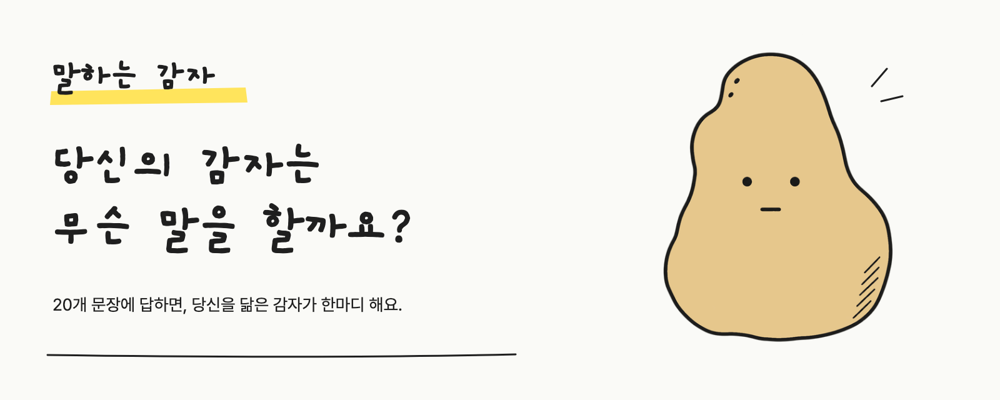
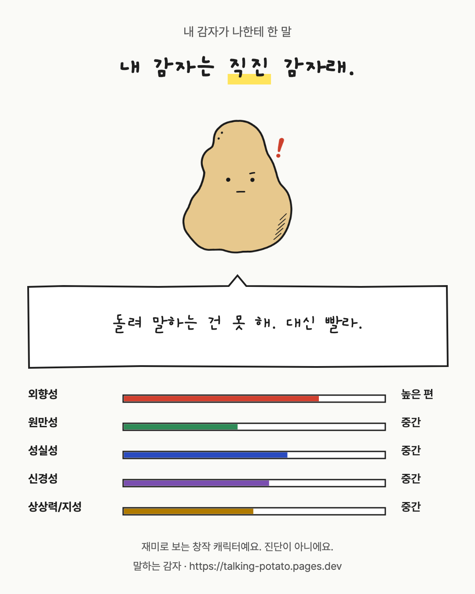
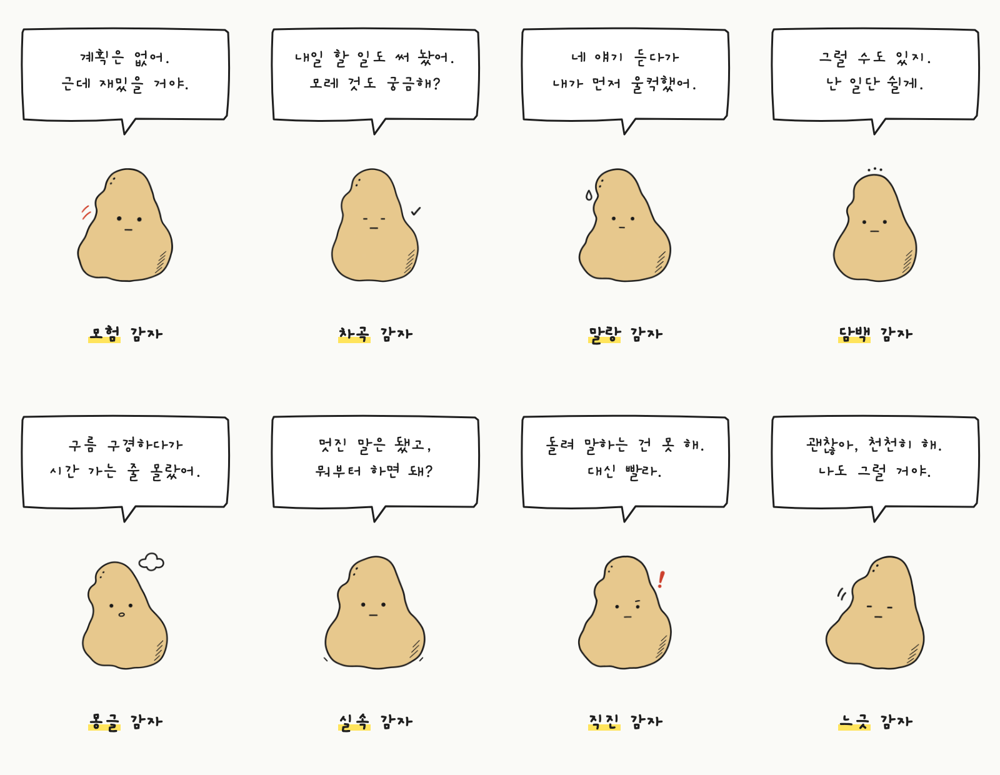
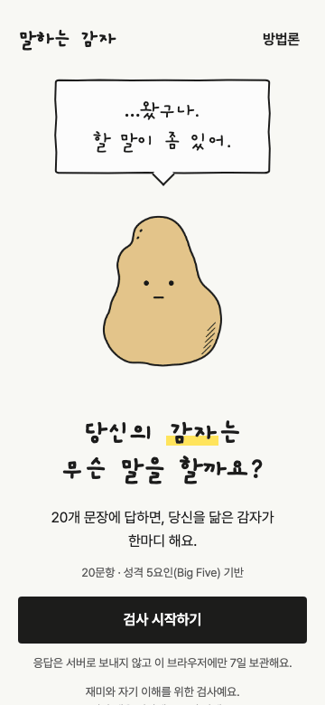
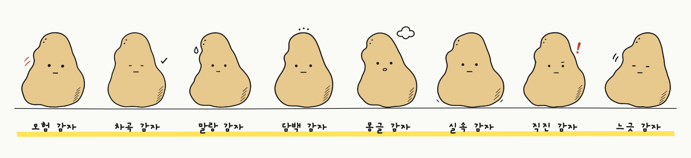

  

<h3 align="center">…왔구나. 할 말이 좀 있어.</h3>

  20개 문장에 답하면, 당신을 닮은 감자 한 알이 나와서 한마디 해요. 
  회원가입 없음 · 응답은 브라우저 밖으로 나가지 않아요

  
   
  <a href="https://talking-potato.pages.dev">talking-potato.pages.dev</a>

  
   
  결과 카드 예시 · 직진 감자

  감자는 점수를 재미있게 요약한 <b>창작</b>이에요 · <b>진단이 아니에요</b> · 한국어 문항은 자체 번역이며 타당화되지 않았어요

---

<h2 align="center">내 감자는 뭐라고 할까?</h2>

  감자는 8종이에요. 어떤 감자가 말을 걸지는 해 봐야 알아요.

  

---

<h2 align="center">이렇게 진행돼요</h2>

  

  <b>①</b> 한 화면에 한 문장, 다섯 단계 중 하나를 골라요. 맞고 틀린 답은 없어요. 
  <b>②</b> 외향성·원만성·성실성·신경성·상상력/지성, 다섯 점수를 0~100으로 내요. 
  <b>③</b> 8종 감자의 대표 좌표 중 점수와 가장 가까운 감자가 나와서 한마디 해요. 
  <b>④</b> 결과 카드로 저장하거나 공유해요. 카드에는 숫자 점수를 넣지 않아요.

  

  
   
  <a href="https://talking-potato.pages.dev">talking-potato.pages.dev</a>

  A tiny personality-flavored toy for Korean speakers. Answer 20 short statements from the public-domain IPIP item pool (Mini-IPIP, Donnellan et al., 2006), and one of eight hand-drawn potatoes shows up with a deadpan one-liner. Scores are computed entirely in your browser and never leave it. The potato is a creative summary for fun, not a validated personality type or a diagnosis. The service is in Korean only.

---

<b>미리 말해 두면</b> — 감자는 유형이 아니에요

- **감자는 성격 유형이 아니에요.** 다섯 점수를 재미있게 요약한 창작이에요. 어떤 감자가 나왔는지보다 막대 다섯 개를 함께 보는 편이 나아요.
- **한국어 문장은 자체 번역이에요.** IPIP 영어 원문을 이 서비스가 직접 옮겼고, 한국어판으로서 신뢰도·타당도는 검증되지 않았어요.
- **진단이 아니에요.** 재미와 가벼운 자기 이해를 위한 검사예요. 심리 진단·상담·채용·선발 같은 판단에는 쓰지 마세요.
- 점수는 다른 사람과 비교한 순위(백분위)가 아니라, 내가 고른 답을 더해 0~100으로 옮긴 값이에요. 특성마다 4문장뿐이라 다시 하면 조금씩 달라질 수 있어요.

<b>개인정보</b> — 서버로 보내지 않아요

- 응답과 점수는 **브라우저 안에서만 계산**해요. 서버로 보내지 않아요.
- 진행 중인 답은 이 브라우저에 저장되고, 마지막으로 답한 날부터 7일이 지나면 다음에 열 때 지워요. 이름·연락처·계정은 받지 않아요.
- 결과 카드는 직접 저장하거나 공유할 때만 기기 밖으로 나가요.
- 방문 통계를 쓰더라도 쿠키 없이 화면 단위로만 세고, 응답·점수·감자 결과는 담지 않아요.

<b>만든 방식</b> — 정적 웹, 서버 없음

- **웹:** React · TypeScript · Vite, 정적 사이트(Cloudflare Pages). 별도 서버와 데이터베이스가 없어요.
- **결과 카드:** 브라우저 Canvas로 1080×1350 PNG를 합성해요. 이미지 생성 모델을 쓰지 않아요.
- **글꼴:** 손글씨 제목과 말풍선은 개구(Gaegu), 본문은 Pretendard를 쓰고, 화면에 쓰는 글자만 남긴 서브셋으로 줄였어요.
- **검수:** 단위 테스트(Vitest), 브라우저 E2E와 접근성 검사(Playwright·axe-core)를 GitHub Actions에서 돌려요.
- 기획·심리측정·디자인·그림·프론트엔드를 역할별 AI 코딩 에이전트(Claude Code, Codex)가 나눠 맡았고, 사람이 방향을 정하고 결과를 승인했어요. 감자 그림은 생성한 후보 중에서 고르고 손봐 확정했어요.

이 저장소는 소개 자료만 담고 있어요. 서비스 소스 코드는 공개하지 않아요.

<b>출처 · 라이선스</b>

- **문항:** Donnellan, M. B., Oswald, F. L., Baird, B. M., & Lucas, R. E. (2006). The Mini-IPIP scales: Tiny-yet-effective measures of the Big Five factors of personality. *Psychological Assessment, 18*(2), 192–203. https://doi.org/10.1037/1040-3590.18.2.192 — 문항은 [International Personality Item Pool](https://ipip.ori.org/)(퍼블릭 도메인)에서 왔어요.
- **글꼴:** [Pretendard](https://github.com/orioncactus/pretendard)(Copyright (c) 2021, Kil Hyung-jin, Reserved Font Name Pretendard), [개구 Gaegu](https://fonts.google.com/specimen/Gaegu)(Copyright 2018 The Gaegu Project Authors). 둘 다 [SIL Open Font License 1.1](https://openfontlicense.org/)을 따라요. 서비스에서는 이름을 바꾼 서브셋(Potato Sans, Potato Hand)으로 배포해요.
- **콘텐츠:** 감자 그림, 감자 이름과 한마디, 화면 문구, 이 README의 이미지는 All rights reserved예요. 자세한 내용은 [LICENSE](LICENSE)를 보세요.

